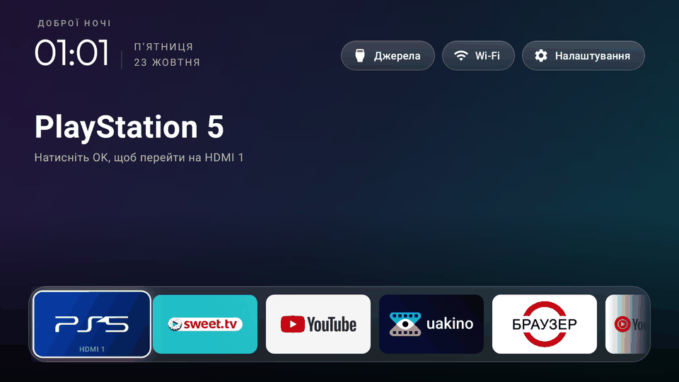
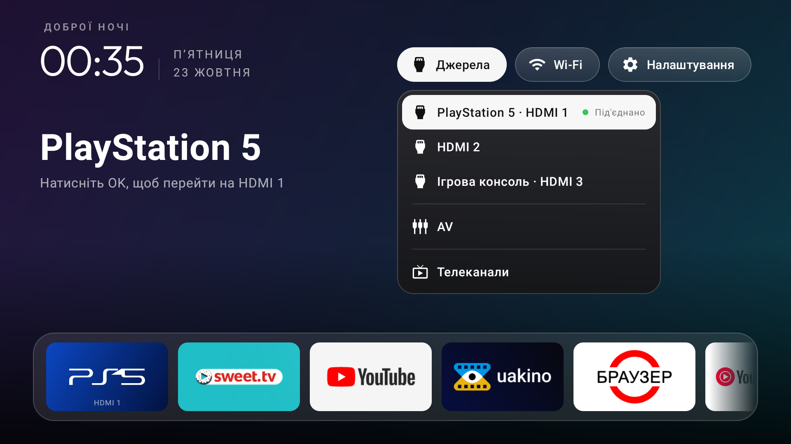
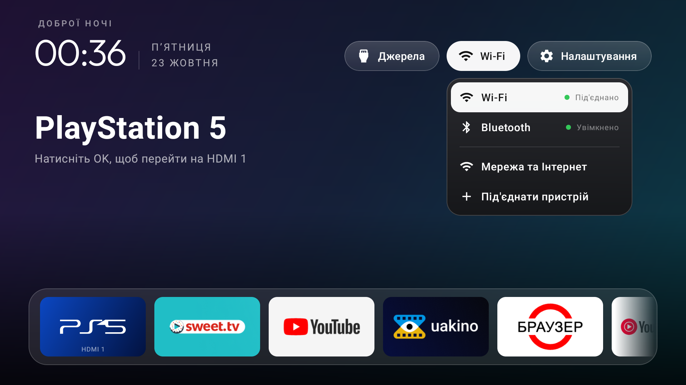
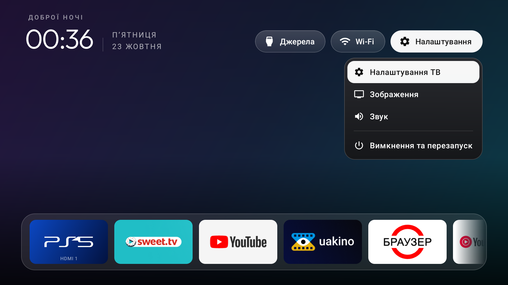
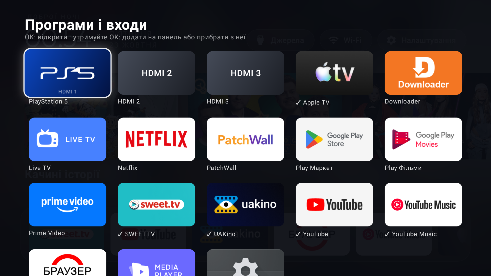
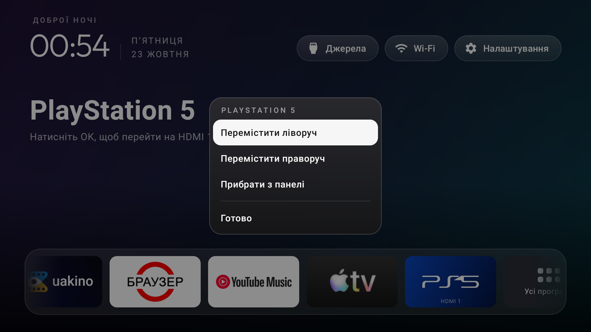
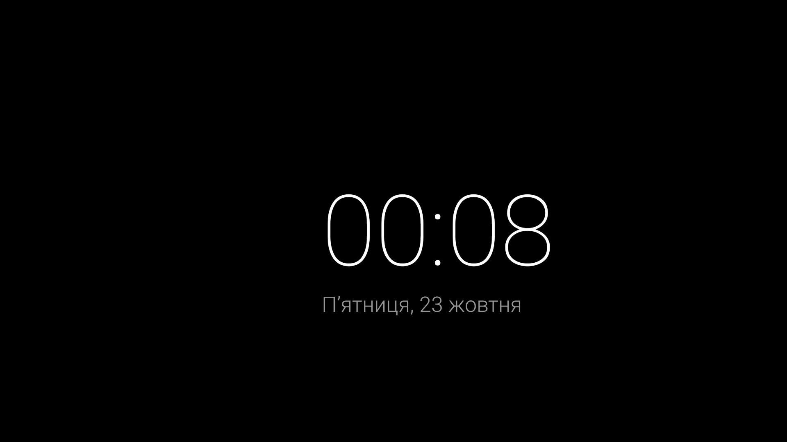

# Дім TV

**Xiaomi TV A 43 2025 без зайвого:** власний легкий лаунчер «Дім», вимкнення реклами й телеметрії через adb і діагностика нестабільної прошивки. Без root, усе можна відкотити.

*A lightweight Apple TV–style launcher, an adb debloat list and diagnostics for the Xiaomi TV A 43 2025 (MiTV-MOOR2, Google TV / Android 11). No root, fully reversible. Docs are in Ukrainian.*



## Що вийшло

| | До | Після |
|---|---|---|
| Вільна пам'ять (`MemAvailable`) | 823 МБ¹ | **931 МБ**¹ |
| Закриття додатків через нестачу пам'яті | 58 за ~29 год | **1** за 40 год² |
| Головний екран у пам'яті | Google TV ~110 МБ | **«Дім» ~58 МБ** |
| Заставка у пам'яті | Google ambient ~160 МБ | **годинник у процесі «Дому»** |
| Реклама, Mi TV+, телеметрія Xiaomi | є | **вимкнено, 21 пакет** |
| PS5 прокидається, коли відкриваєш HDMI 1 | так | **ні** |

¹ «До» заміряно після доби роботи, «після» — через 1,5 хв після старту, тож порівняння приблизне. ² У ці дні ТВ вмикали ненадовго.

## Скріншоти

| | |
|---|---|
|  |  |
| **Джерела**: HDMI з назвою пристрою та станом, AV, телеканали | **Мережа**: Wi-Fi, Bluetooth, налаштування мережі |
|  |  |
| **Налаштування**: відкривається й кнопкою ⚙ на пульті | **Усі програми й входи**: утримання OK додає на панель |
|  |  |
| **Меню плитки**: перемістити або прибрати | **Заставка**: годинник, раз на хвилину зсувається |

## Лаунчер «Дім»

Kotlin + Jetpack Compose for TV, APK ~2 МБ, тільки armeabi-v7a. Код і подробиці: [`launcher/`](launcher/README.md).

- **Панель додатків і входів** унизу, над нею «Дивитися далі» і добірки від додатка у фокусі (TvProvider), фон розмивається з картки.
- **Верхня панель** у стилі [CleanYourTV](https://github.com/Gathin23/cleanyourtv): вітання, годинник Outfit, дата, кнопки-пілюлі «Джерела», Wi-Fi, «Налаштування» з меню, що розгортаються вниз.
- **PS5 не прокидається.** Плитка відкриває сам HDMI-порт, а не CEC-вхід консолі: ТВ надсилає лише `<Routing Change>`, без `<User Control Pressed>[Power]`. Назва пристрою кешується, тож логотип PS5 лишається і тоді, коли консоль вимкнена.
- **Кнопки пульта** працюють і без Google TV: Home, ⚙, APPS, Netflix, Prime Video, YouTube. Утримання YouTube відкриває YouTube Music, утримання Netflix відкриває UAKino.
- **Заставка-годинник** замість Google ambient mode.
- **Мало пам'яті**: банери декодуються в розмірі плитки, кешуються між поверненнями на головний екран, кеш картинок ~10 МБ.

## Дебладінг

[`docs/debloat.md`](docs/debloat.md): 21 пакет, вимкнений чотирма партіями. Після кожної — перезавантаження і перевірка пульта, HDMI і додатків. Для кожного пакета записано, що це, і команду відкату. Не вимкнулись (прошивка повертає їх при старті): PatchWall і Google Асистент.

Список звірено з перевіреним списком CleanYourTV для цієї ж моделі ([`xiaomi-mitv-moor2`](https://github.com/Gathin23/cleanyourtv/blob/main/examples/xiaomi-mitv-moor2/debloat.txt)). Не чіпаємо: `com.mitv.livetv` (перемикач джерел), `mitv.service`, `com.mitv.overseaservice` (кнопка Netflix), `com.mediatek.*`, `com.mi.bluetooth`, `com.google.android.tv.remote.service`, служби оновлень і `setupwraith`.

## Діагностика і прошивка

- [`docs/diagnostics/`](docs/diagnostics/): пам'ять, процесор, температура і причини перезавантажень до та після дебладінгу.
- [`docs/firmware.md`](docs/firmware.md): чому в ТВ, купленого в Україні, заводський регіон `ru`, чому OTA не пропонує новішої прошивки (2674 є на інших MOOR2) і чому регіон не змінити без root.

**Чого це не виправляє:** ТВ час від часу перезавантажується через kernel panic, зокрема під час повного вимкнення. Це прошивка або залізо: дебладінг лише робить ТВ швидшим, не стабільнішим.

## Як поставити

Потрібні: увімкнене налагодження USB на ТВ, `adb`, JDK 17 і Android SDK. Порядок важливий, інакше кнопка Home може відкрити заводське меню або порожній екран.

```bash
adb connect <tv-ip>:5555

# 1. Зібрати й поставити «Дім»
cd launcher
./gradlew assembleRelease
adb install -r app/build/outputs/apk/release/app-release.apk
adb shell pm grant ua.home.launcher android.permission.READ_TV_LISTINGS

# 2. Увімкнути службу «Дім: кнопка Home» на ТВ (тільки вручну, пультом)
adb shell am start -n com.android.tv.settings/.oemlink.AccessibilitySettingsActivity

# 3. Лише після цього вимкнути Google TV launcher
adb shell pm disable-user --user 0 com.google.android.apps.tv.launcherx

# 4. Заставка-годинник
adb shell settings put secure screensaver_components ua.home.launcher/.ClockDream
```

Далі — пакети з [`docs/debloat.md`](docs/debloat.md), партіями, з перезавантаженням між ними.

**Відкат:** спочатку `adb shell pm enable com.google.android.apps.tv.launcherx`, потім `pm enable` для пакетів зі списку. Перед скиданням до заводських налаштувань увімкніть усе назад.

**Обережно:**
- `adb shell am force-stop ua.home.launcher` вимикає службу кнопки Home (Android 11 так поводиться). Відновлення — у [`launcher/README.md`](launcher/README.md).
- `com.google.android.tungsten.setupwraith` не вимикайте: його вимкнення може стерти Wi-Fi мережу, збережену під час першого налаштування, а на сусідній моделі (MOSR4) перезавантаження на його екрані скинуло ТВ до заводських налаштувань. «Дім» обходить його службою спеціальних можливостей.
- Не відкривайте заводське меню (`com.duokan.factorytest`).

## Пристрій

| | |
|---|---|
| Модель | Xiaomi TV A 43 2025, `MiTV-MOOR2` (codename `venom`, продукт `flipped`) |
| Платформа | MediaTek / MStar `m7632`, 1,8 ГБ RAM, панель 4K 43" |
| ПЗ | Google TV, Android 11, `RTM5.220609.003.1917` (2024-04-21), патч безпеки 2024-03-01 |
| Пульт | Xiaomi RC, Bluetooth LE |

## Структура

```
launcher/              лаунчер «Дім» (Android, Kotlin, Compose for TV)
docs/debloat.md        вимкнені пакети, партії, перевірки, відкат
docs/firmware.md       регіон, OTA, варіанти оновлення
docs/diagnostics/      звіти діагностики
docs/launcher-plan.md  як вибирали підхід до лаунчера
docs/screenshots/      скріншоти
```

## Подяки й ліцензії стороннього

- Стиль верхньої панелі й меню, іконки входів: [CleanYourTV](https://github.com/Gathin23/cleanyourtv), MIT — [`launcher/LICENSE-cleanyourtv.txt`](launcher/LICENSE-cleanyourtv.txt).
- Шрифт [Outfit](https://github.com/Outfitio/Outfit-Fonts), SIL OFL 1.1 — [`launcher/FONT-LICENSE-OFL.txt`](launcher/FONT-LICENSE-OFL.txt).
- Логотип PS5: [Simple Icons](https://simpleicons.org/), CC0. PlayStation — торговельна марка Sony Interactive Entertainment.
- Іконки інтерфейсу: Material Icons (Google), Apache 2.0.

Назви й логотипи додатків на скріншотах належать їхнім власникам.

## Ліцензія

Власний код і документація — [MIT](LICENSE). Сторонні шрифт, іконки й запозичений код — за їхніми ліцензіями, див. вище.
